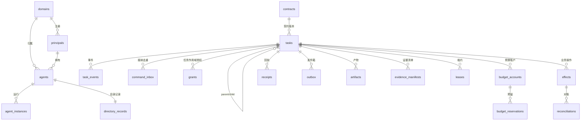

# 02 · 数据模型与存储设计

状态：v0.1 草案 ｜ 上游：总体方案 §13.1、§13.4 ｜ 权威工件：[`schema/001_core.sql`](../../schema/001_core.sql)

本文件解释 DDL 的结构与理由；**字段级权威定义以 SQL 文件为准**，两处不一致时改 SQL、同步文档。

## 1. 存储原则

1. **单一权威状态源**：任务的权威状态只由本域 PostgreSQL 状态机决定。消息队列（后续 NATS JetStream）只做唤醒与投递；工作流引擎（后续 Temporal）只做驱动，二者不得独立决定对外任务状态（总体方案 §13.3）。
2. **数据库事务不跨外部网络调用**：所有需要原子性的写入收进单库事务；外部调用发生在提交之后，结果不明走对账（04 §6）。
3. **命令与事件分离**：`tasks` 等表保存当前状态（可更新、带版本），`task_events` 保存仅追加的决策与事实（恢复重放依据，04 §8）。
4. **账本三分离**：金额预算（`budget_*`）、业务操作（`effects`）、回执（`receipts`）各自独立，分别对应总体方案 §八/§十 的对象。

## 2. 实体关系总览

表分组与职责：

| 分组 | 表 | 职责文档 |
|---|---|---|
| 身份与目录 | `domains principals agents agent_instances directory_records` | 01、07 |
| 任务与契约 | `contracts tasks task_events` | 03 |
| 命令接纳 | `command_inbox message_inbox` | 04 §3 |
| 授权 | `grants` | 06 |
| 预算 | `budget_accounts budget_reservations` | 05 |
| 业务操作 | `effects reconciliations` | 04 |
| 回执与外发 | `receipts outbox` | 03 §8、04 §2 |
| 产物与证据 | `artifacts evidence_manifests` | 09 |
| 租约 | `leases` | 04 §5 |
| 审计 | `audit_log` | 10 |
| DP | `dp_purposes dp_releases` | 11 |

## 3. 关键设计说明

### 3.1 `tasks`：状态、版本与 epoch 三线合一

- `task_version`：每次实质 UPDATE 必须递增（触发器强制）。用途：① 乐观并发（API 携带 `expected_task_version`）；② 与命令封装中的 `expected_task_version` 对应，检测并发交错。
- `current_epoch`：接管/fencing 代次。旧 epoch 的 `effects` 接纳在 T2 事务内被拒（04 §5）。epoch 变化也要求版本递增。
- `peer_task_ref`：跨域任务保存对端句柄（对端域、对端 task_id、发起 command_id），是"远端已创建任务但句柄丢失"窗口的恢复锚点（04 §3.3）。
- `limits`：根任务写入全局限额快照，子任务继承只读副本（05 §6），保证限额在恢复重放后语义一致。

### 3.2 `command_inbox`：去重键与保留期

- 主键 `(command_id, audience_domain_id)`：同一逻辑命令发往不同域是不同接纳。
- `expires_at`（去重保留期）**必须 ≥ 允许的重试窗口**（04 §3.2），默认 168h，重试窗口默认 ≤ 24h。
- 过期命令的重放被拒绝（`ANET-CMD-EXPIRED`），进入显式恢复流程，不做静默重执行。

### 3.3 `effects`：I3 的绑定三要素

同一 `effect_id` 再次出现时，`params_digest` 与 `authority_digest` 必须与首次接纳一致，否则登记 `CONFLICT` 并拒绝。数据库层以主键保证唯一，绑定检查在 T2 接纳事务内完成（04 §4.2）。

### 3.4 `budget_accounts` / `budget_reservations`：S+R≤B

- `settled`（S）+ `HELD/SETTLED` 预留之和（R）≤ `budget_limit`（B）。权威执行方式：TCS 对账户行 `SELECT ... FOR UPDATE` 后原子检查（05 §3）；延迟约束触发器 `trg_budget_invariant` 作为实现缺陷的兜底。
- `delegated`：切给子域独立账本的不可再分配额度，防止"子域内部预留重复计入根账本"（总体方案 §10.1 末条）。

### 3.5 `task_events` / `audit_log`：分区与仅追加

- 均按月 RANGE 分区；热保留与归档策略见 12 §5。
- 审计表通过**数据库角色**实施仅追加：`anet_audit_append` 只有 `INSERT` 权限，无 `UPDATE/DELETE`（02 §6）。

## 4. 事务与并发策略

| 规则 | 内容 |
|---|---|
| 隔离级别 | 默认 READ COMMITTED；正确性不依赖 SERIALIZABLE，靠显式行锁 |
| 锁序 | 任一事务内按固定顺序加锁：`tasks` 行 → `budget_accounts` 行（按 `account_id` 字典序）→ 其余表。禁止反序，杜绝死锁 |
| 三个提交时点 | T1 任务接纳 / T2 业务操作接纳 / T3 取消（03 §6）；全部为单库短事务 |
| 外部调用 | 一律在提交后由适配器执行（outbox 模式） |
| 失败重试 | 乐观并发冲突（版本不变）由调用方带退避重试；行锁等待超时 `db.lock_timeout = 2s` |

## 5. 容量与增长模型（承接总体方案 §13.4）

基线假设：1,000 活跃 Agent、每 5s 一条控制消息 ⇒ 200 msg/s。按下表估算（公式化，便于按实际负载重算）：

| 表 | 写入速率估算 | 行大小（含索引） | 日增量 | 热保留策略 |
|---|---|---|---|---|
| `task_events` | ≈ 控制消息数的 50%（≈100/s） | ~1.5 KiB | ≈ 860 万行 / ~13 GiB | 180 天热，之后 detach 归档（12 §5） |
| `audit_log` | ≈ 每接纳/决策 1 行（≈150/s） | ~0.6 KiB | ≈ 1,300 万行 / ~8 GiB | 365 天热 |
| `outbox`（终态行） | ≈ 消息数 | ~1 KiB | ≈ 1,700 万行 / ~17 GiB | DONE 行保留 7 天后清理 |
| `command_inbox` | ≈ 命令数 | ~0.2 KiB | 按 `expires_at` 滚动清理 | ≤168h |
| `receipts` / `effects` | 命令/操作数 | ~0.5 KiB | 与任务量线性 | 随任务归档 |

结论（与总体方案一致）：**带宽不是第一瓶颈，长期记录积累才是**。因此：① 事件与产物分离（产物入对象存储，事件只存引用与摘要）；② 分区 + 定期归档是 M1 必须项而非 M4 优化项；③ 大载荷一律走 ART 引用，禁止整包进事件。

## 6. 数据库角色与访问控制

| 角色 | 权限 | 使用者 |
|---|---|---|
| `anet_app` | 业务表 DML（无 TRUNCATE/DROP） | TCS |
| `anet_audit_append` | 仅 `audit_log` 的 INSERT | GW、ICS、TCS 审计路径 |
| `anet_readonly` | 全表 SELECT | 观测、对账工具 |
| `anet_ddl` | 迁移专用 | 迁移任务（CI 执行） |

密钥、令牌、完整提示词**没有**对应列——不存储即不泄露（10 §4）。

## 7. 迁移策略

- 前向迁移，编号即序（`001_core.sql`、`002_...`）；expand-contract：先加新表/新列，双写验证后删除旧路径。
- 每次迁移必须附带回滚说明（恢复到前一快照 + PITR，见 12 §4）。
- 触发器与约束的变更随迁移走，禁止线上手工 DDL。
