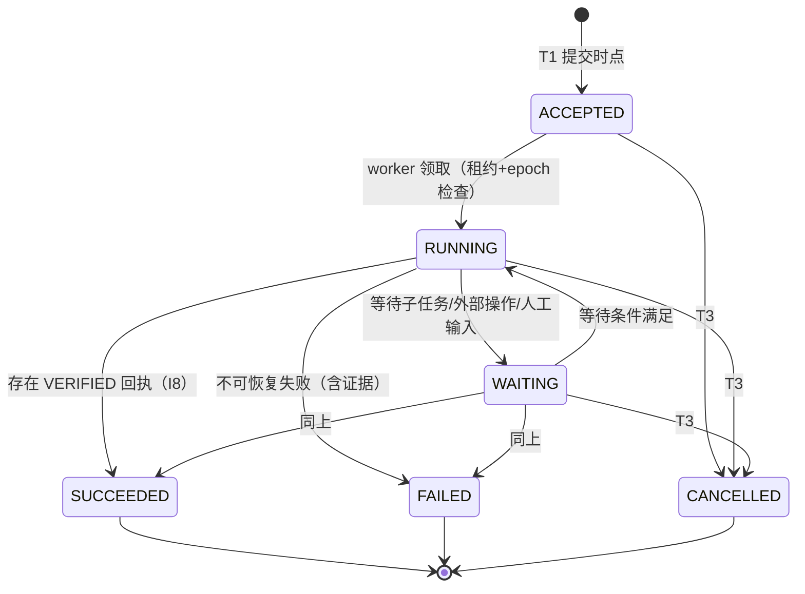

# 03 · 任务控制服务（TCS）设计

状态：v0.2.2（2026-10-27 复审修订）｜ 上游：总体方案 §5.3、§六、§8、§13.2 ｜ 前置：01、02 ｜ 整改对照：15 §三/§四/§五/§六/§九

## 1. 职责与边界

TCS 是本域任务协作的**唯一权威控制面**：命令接纳（去重）、任务状态机、版本/epoch 分配、预算账本、业务操作接纳、回执签发、outbox 投递。模型推理与计划生成（RUN）、权限策略判定（ICS 是 PDP）、协议编解码（GW/ADP）、产物内容管理（ART）不属于 TCS。部署：MVP 单主+热备；分片属 M4（12 §3）。

## 2. 任务契约（Contract）

`contracts.body` 的规范结构（JSON Schema 2020-12 摘要）。自然语言 `goal` 便于理解；**其余字段是执行约束，程序检查，摘要/压缩不得改写**（09 §2）。

```json
{
  "contract_id": "con_0192...",
  "version": 7,
  "goal": "分析私有实验数据集 D，产出周报级统计表与可追溯报告",
  "input_refs": [
    {"artifact_id": "art_0190...", "digest": "sha256:…", "version": 3, "data_class": "confidential"}
  ],
  "output_schema": {"$ref": "https://schemas.<domain>/stat-report-2026-07.json"},
  "acceptance_policy": {
    "verifier": "stat-report-v2",
    "checks": ["sample_range", "units", "code_reproducible", "stat_consistency"],
    "on_fail": "report"                       // report | retry_once | human
  },
  "constraints": {
    "time_range": {"from": "2026-09-01", "to": "2026-09-30"},
    "units": "SI",
    "language": "zh-CN",
    "data_boundary": {"row_level_egress": false, "allowed_domains": ["dom_lab_b"]}
  },
  "authority_ref": "grt_0191...",
  "budget_ref": "acc_0191...",
  "deadline": "2026-11-01T09:00:00Z",
  "delegation_policy": {"allow": true, "max_depth": 3, "scope": ["search", "compute", "review"]},
  "evidence_policy": {
    "required": ["input_versions", "method", "artifacts", "provenance"],
    "retention_days": 365
  },
  "recovery_policy": {
    "on_disconnect": "resume",
    "on_unknown_effect": "reconcile_then_escalate",
    "on_validation_fail": "report",
    "offline_allowlist": []                   // 失联期间仍可接纳的操作类（06 §5.4）
  }
}
```

规则：

- R2.1 契约一经接纳即不可变；修改 = 新版本号 + 新 digest，存量任务继续引用旧版本。
- R2.2 `goal` 允许自然语言；`constraints/acceptance_policy` 必须机器可判定（MVP 限定为上表枚举的检查项，验证器接口见 09 §7）。
- R2.3 "分析这份数据"级别的模糊契约在接纳时被拒（`ANET-CMD-CONTRACT-INVALID`）：缺 `input_refs` 版本、`output_schema`、`budget_ref`、`deadline` 任一项不得接纳。

## 3. 命令封装（Command Envelope）

字段规范（v0.2 变更标注 ▲）：

| 字段 | 填写方 | TCS 校验 |
|---|---|---|
| `profile` | 调用方 | 匹配 `agent-network/0.1` |
| `command_id` | 调用方（幂等键） | 去重（04 §3） |
| ▲ `not_after` | 调用方提议、**GW 签名绑定** | T1 无条件 `now() ≤ not_after`；inbox `expires_at ≥ not_after`（评审 §6.1：防去重记录清理后重放建新任务） |
| `task_id` / `parent_task_id` | 调用方 | 存在、未终态；委托深度 |
| `caller_ref` | GW 覆盖写入 | 等于已验证令牌身份 |
| `audience` | 调用方 | 在授权 audience 内 |
| `contract_ref` | 调用方 | digest 一致 |
| `authority_ref` / `reservation_ref` | TCS 签发回填 | 见 §6 |
| `expected_task_version` | 调用方 | 不匹配 ⇒ `ANET-TSK-VERSION-CONFLICT` |
| `evidence_manifest_ref` / `payload_digest` | 调用方 / GW | 摘要一致（I3，RFC 8785 JCS） |

## 4. TCS API（gRPC `anet.tcs.v1`）

MVP 服务方法（SDK 边缘由 GW 暴露 HTTPS/JSON 等价物）：

| 方法 | 用途 | 关键语义 |
|---|---|---|
| `SubmitCommand(env) → AdmissionResult` | 任务接纳（T1） | 幂等：重复 `command_id` 返回既有结果；参数不一致返回冲突 |
| `GetTask(task_id) → TaskSnapshot` | 查询 | 快照含状态/版本/epoch/效果/回执/预算摘要/子任务 |
| `UpdateTaskStatus(task_id, from→to, expected_version, evidence) → TaskSnapshot` | 状态迁移 | 状态机守卫（§5）；SUCCEEDED 需 VERIFIED 回执（I8） |
| `CreateSubtask(parent, contract, shrunk_rights) → AdmissionResult` | 子任务委托 | §7，一次事务完成收缩授权 + 子账户 + 事件 |
| `AdmitEffect(effect 提议) → EffectAdmission` | 业务操作接纳（T2） | 04 §4 |
| `ReportEffectResult(effect_id, attempt_id, outcome, usage) → EffectState` | 结果上报 | COMMITTED/REJECTED/UNKNOWN；结算联动（05 §5） |
| `CancelTask(task_id, cause) → CancelResult` | 取消（T3） | §6.3 |
| `CloseSubtaskBudget(child_task_id) → SubtaskBudgetCloseout` | 本域子账本结清（29） | 仅从权威账本汇总成本/归还余额，重复返回首次结果 |
| `ReserveBudget / SettleReservation / ReleaseReservation` | 预算（05 §3–§5） | — |
| `AcquireLease / RenewLease(task_id, worker, epoch)` | 租约（04 §5） | 续期失败 ⇒ 接管流程 |
| `ListUnknownEffects(filter) → [...]` | 对账工作队列 | 04 §6 |

所有写方法的响应都包含"提交后"的权威状态，调用方不得自行推断。

v0.2 接口变更（详见 proto）：

| 方法 | 变更 |
|---|---|
| `SubmitCommand` | 增 `not_after`；返回幂等语义不变 |
| `CreateSubtask` | 签名封装绑定父租约/版本、接收方策略、权限与四维预留；版本与重放语义见 §8 |
| `AdmitEffect` | 增 `lease_id`、`expected_task_version`、`reservations[]`（按维度）、`authz`（绑定式授权决定，§6.2） |
| 其余方法 | 不变 |

## 5. 任务状态机



迁移守卫（`UpdateTaskStatus` 逐条检查）：

| 迁移 | 守卫 |
|---|---|
| `→ RUNNING` | 存在有效租约且 `lease.epoch = current_epoch` |
| `→ SUCCEEDED` | 全部必需 effect 已达到契约要求的结果，且无 ADMITTED/UNKNOWN；VERIFIED 绑定契约版本、输出摘要、证据清单版本、验证器版本（09 §7）；`auto_accept` 也须由对应验证器出具该绑定回执 |
| `→ FAILED` | 附失败原因与至少一项证据引用；存在 UNKNOWN 或 ADMITTED 业务操作时**不得**报 FAILED（先对账，04 §6.4） |
| `→ CANCELLED` | 仅经 T3 路径；任何组件不得绕过取消记录直接改状态 |
| 终态 → 任何 | 拒绝（触发器 `trg_task_guard` 兜底，I4） |

任务状态与业务操作状态**分线维护**：任务 CANCELLED 后，已接纳 effects 继续对账直至终态（04 §7），二者互不掩盖。

## 6. 三个提交时点（T1 / T2 / T3）

### 6.1 T1 任务接纳（v0.2：插入顺序修正 + 命令时效）

```text
SubmitCommand(env):
BEGIN;                                        -- 新对象按 FK 顺序写入；不存在的 inbox 行不能行锁
  IF clock_timestamp() > env.not_after:                   -- 无条件时效检查（自包含，不依赖去重记录存在）
      ABORT ANET-CMD-EXPIRED;

  row := SELECT * FROM command_inbox
         WHERE command_id=env.command_id AND audience_domain_id=env.audience;
  IF row EXISTS:
      IF row.payload_digest ≠ env.payload_digest:
          ABORT ANET-CMD-PARAMS-CONFLICT;     -- I3：拒绝响应，不改写既有绑定
      COMMIT;  RETURN {EXISTING, row.task_id, 原 ACCEPTED 回执};

  IF 契约不完整（R2.3）: ABORT ANET-CMD-CONTRACT-INVALID;
  IF 当前时刻 > contract.deadline: ABORT ANET-TSK-DEADLINE;

  -- 顺序修正（评审 §9.2）：先建任务，再写去重映射（command_inbox.task_id 是即时 FK）
  task := INSERT tasks(status=ACCEPTED, version=1, epoch=1, limits=根限额快照, ...);
  INSERT command_inbox(task_id=task.task_id,
                       not_after=env.not_after,
                       expires_at=GREATEST(now()+tcs.dedup_retention, env.not_after));
  INSERT contracts(若新); INSERT grants(初始授权);
  IF 根任务: INSERT budget_accounts(每维度);
  INSERT task_events(TASK_ACCEPTED);
  rct := INSERT receipts(ACCEPTED, issuer=本域);             -- I1：COMMIT 后才返回
  INSERT outbox(TASK_ACCEPTED);
COMMIT; RETURN {rct, task.task_id};
```

时效比较使用 `clock_timestamp()` 所代表的可信当前时刻，不能使用 PostgreSQL 固定于事务开始的 `now()`。等待锁或唯一键冲突后必须重新检查，时效以接纳事务的串行化点为准。

并发重复命令：两事务竞争同一 `(command_id, audience)` 唯一键，后到者因唯一键冲突回滚整个事务（含临时 task），在新事务中重新检查时效并读取 inbox，按 EXISTING 返回；不得在已 aborted 的事务内继续查询。

### 6.2 T2 业务操作接纳（v0.2：租约持有者 + 授权决定绑定 + 版本 + 多维预留 + 冲突=拒绝）

```text
AdmitEffect(prop):        -- prop: effect_id, task_id, lease_id, epoch, params_digest,
                          --       authority_digest, reservations[](维度), authz 决定
BEGIN;                                        -- 锁序：tasks → accounts(字典序) → reservations(字典序) → effects
  t := SELECT * FROM tasks WHERE task_id=prop.task FOR UPDATE;

  校验 authenticated_caller 对该任务的查询/提交权限（复用既有结果也不能绕过授权）；
  e := SELECT * FROM effects WHERE effect_id=prop.effect_id;
  IF e EXISTS:
      IF e.task_id ≠ prop.task_id: ABORT ANET-EFF-PARAMS-CONFLICT;
      IF e.params_digest = prop.params_digest AND e.authority_digest = prop.authority_digest:
          COMMIT; RETURN {EXISTING, e};        -- 已发生事实；不再次授权执行或占用预算
      INSERT effect_conflict_attempts(presented=prop.params_digest, bound=e.params_digest);
      INSERT audit_log(effect.conflict_rejected);
      COMMIT; RETURN ANET-EFF-PARAMS-CONFLICT; -- 本分支没有其他业务写入，保留拒绝审计
  -- 以下时效、租约、版本守卫仅用于首次接纳；重试不要求旧 expected_version 再次相等。

  IF t.status IN 终态:            ABORT ANET-EFF-TASK-TERMINAL;
  IF t.cancel_version IS NOT NULL: ABORT ANET-EFF-TASK-CANCELLED;   -- I9
  IF prop.epoch ≠ t.current_epoch: ABORT ANET-EFF-FENCED;           -- I2（代次，非执行权）
  IF clock_timestamp() > t.deadline:          ABORT ANET-TSK-DEADLINE;          -- deadline 守卫
  IF prop.expected_task_version ≠ t.task_version: ABORT ANET-TSK-VERSION-CONFLICT;

  -- 执行权绑定（评审 §5.1）：epoch 相等 ≠ 持有租约。
  -- 已认证实例（gRPC 对端身份，非请求字段）必须是当前有效租约的 holder：
  lease := SELECT * FROM leases WHERE task_id=prop.task
             AND lease_id=prop.lease_id AND superseded_at IS NULL;
  IF lease IS NULL OR lease.expires_at < clock_timestamp()
     OR lease.epoch ≠ t.current_epoch
     OR lease.worker_instance_id ≠ authenticated_caller_instance:   -- 关键：实例绑定
      ABORT ANET-EFF-LEASE-INVALID;

  -- 授权决定绑定（评审 §5.2）：决定必须与本次操作逐字段一致（ICS→TCS 可信通道/签名句柄）
  CheckAuthzBinding(prop.authz, prop):
      authz.allow = TRUE
      AND authz.subject         == 权威 tasks.owner_principal_id（原用户）
      AND authz.actor          == 已认证调用 Agent/实例（委托时可属于另一 principal）
      AND authz.task_id         == prop.task_id
      AND authz.action/resource == prop.target.action/resource
      AND authz.params_digest   == prop.params_digest
      AND authz.grant_id        ∈ 任务有效授权链（未撤销）
      AND authz.audience        == prop.audience
      AND authz.sensitivity     == prop.sensitivity
      AND clock_timestamp() - authz.at ≤ authz.sensitive_max_age(敏感级)
      AND authz.decision_id 可在 ICS 持久查证（防伪造传递）
    任一不符 ⇒ ANET-AUT-DECISION-MISMATCH

  -- 多维预留绑定（05 §4）：reservations[] 全维度校验并独占绑定，任一失败整体拒绝
  accs := 按 account_id 字典序 FOR UPDATE 锁定各预留所属账户；
  rows := 按 reservation_id 字典序 FOR UPDATE 锁定预留并重新核对归属；
  对服务端根据操作定义确定的每个必需维度（不由提案决定是否省略）:
      恰好一笔 res，res.state=HELD，res.effect_id/attempt_id 均为空；
      res.holder_task_id=prop.task_id，acc.task_id=prop.task_id，acc.dimension=该维度；
      purpose 匹配，res.amount >= 该维度的可执行上界；
  任一失败: ABORT ANET-EFF-RESERVATION-INVALID;
  再采样 clock_timestamp()，在锁等待后复核 deadline、lease.expires_at 与授权新鲜度；
  UPDATE 所有预留 SET effect_id=prop.effect_id;

  INSERT effects(state=ADMITTED, epoch=t.current_epoch, ...);
  UPDATE tasks SET task_version = task_version + 1;              -- 版本递增（评审 §5.3）
  INSERT task_events(EFFECT_ADMITTED);
COMMIT;                                        -- 外部调用在提交后由 ADP 执行（04 §4.3）
```

> 事务语义：`ABORT` 表示回滚整个事务并返回拒绝。冲突分支只追加冲突与审计行后 COMMIT 并返回拒绝，不修改原 effect、预留或任务版本。同一任务行锁串行化首次接纳；跨任务碰撞同一 effect_id 时，唯一键失败者回滚后按已存在分支重读并复核归属。

### 6.3 T3 取消

```text
CancelTask(task_id, cause):
BEGIN;
  t := SELECT * FROM tasks WHERE task_id FOR UPDATE;
  IF t.status IN (SUCCEEDED, FAILED):
      ABORT ANET-TSK-TERMINAL;                -- 已完成/已失败的任务不"取消"
  IF t.status = CANCELLED:
      COMMIT; RETURN {EXISTING, t.cancel_version};             -- 取消幂等
  UPDATE tasks SET status='CANCELLED', cancelled_at=now(),
         cancel_version=COALESCE(cancel_version,0)+1,
         task_version=task_version+1;
  INSERT task_events(CANCELLED, cause);
  INSERT outbox(CANCELLED);                    -- 投递器：本域子任务逐个 T3；跨域发取消命令
COMMIT;
RETURN {t.cancel_version};
```

取消语义（总体方案 §8.6 的落地）：T3 提交后，本域**不再接纳**该任务任何新操作（T2 守卫）；**已接纳**操作继续执行/对账直至终态，其结果照常写入 `effects/receipts`。跨域取消是"请求 + 对端确认"：本地取消不表述为对端已停止（08 §4.5）。

## 7. 子任务创建（委托）

`CreateSubtask` 单事务完成四件事（缺一即整体失败）：

1. 契约校验：子契约满足 R2.3；`delegation_policy.allow`；`parent.depth + 1 ≤ max_depth`；
2. 权限收缩：`Rights_child ⊆ Rights_parent ∩ Policy_recipient`（判定算法 06 §3），生成子 `grants` 记录；
3. 预算分配：父账户下建子账户（父账户 HELD 预留退出 H，同事务增加 D，并建立等额子账户，05 §8）；
4. `task_events(SUBTASK_CREATED)` + outbox（如跨域，由 ADP 发起对端接纳）。

跨域子任务的权威在对端域；本域保存 `peer_task_ref` 与 ACCEPTED 回执，**不**镜像对端内部状态。

## 8. 写 API 版本与幂等语义表（v0.2 新增；评审 §5.3）

| API | 读版本 | 检查 | 成功递增 | 重复请求返回 |
|---|---|---|---|---|
| `SubmitCommand` | —（新任务） | `not_after`、契约完整性 | `task_version=1` | EXISTING + 原 ACCEPTED 回执 |
| `CreateSubtask` | 父任务版本 | 签名期限、expected_version、租约/epoch、契约/权限/接收方/预留 | 父版本+1，子版本=1 | 期限内返回原子任务/grant/ACCEPTED 回执 |
| `AdmitEffect` | `tasks.task_version` | `expected_task_version` 相等 | `task_version+1` | EXISTING + 原 effect 状态 |
| `UpdateTaskStatus` | `tasks.task_version` | `expected_version` 相等 | `task_version+1` | 幂等（同目标状态）或冲突 |
| `CancelTask` | — | 终态守卫 | `task_version+1; cancel_version+1` | EXISTING + 原 cancel_version |
| `CloseSubtaskBudget` | 首次结清记录与父子账本 | 管理身份、终态、无未结责任、原分配绑定 | 无任务版本变化 | 原四维结清结果 + existing |
| `Reserve/Settle/Release` | 预留行状态 | 状态机守卫 | 无任务版本变化 | 幂等（状态已变更则返回现值） |

## 9. Outbox 与投递器

- 事务内只写 `outbox` 行；投递器进程轮询 `status='PENDING' AND next_attempt_at<=now()`，按 `dedup_key`（`peer+message_id`）幂等投递，指数退避（`tcs.outbox_max_attempts=16`，超限转 `DEAD` 并告警）。
- MVP 投递器为进程内后台协程；M2 起可替换为 NATS JetStream 唤醒（权威事实仍在库，02 §1）。

实现进展（2026-10-27，17）：领取增加令牌和期限，过期后可回收；旧令牌不能写回新尝试。接收侧对源域/目标/dedup_key 及消息内容持久去重；DEAD 与死信告警源记录原子写入。当前为本域通知投递，收件成功不等于业务执行成功。

## 10. 配置参数（初始值）

| 参数 | 默认 | 说明 |
|---|---|---|
| `tcs.dedup_retention` | 168h | expires_at=max(received_at+保留期, not_after)；仅删除 expires_at < 当前时刻的行 |
| `tcs.command_retry_window_max` | 24h | 调用方重试窗口上限 |
| `tcs.lease_ttl` | 30s | worker 租约 |
| `tcs.lease_grace` | 15s | 接管判定 = 过期 + grace |
| `tcs.outbox_max_attempts` | 16 | DEAD 前投递次数 |
| `db.lock_timeout` | 2s | 行锁等待上限 |
| `limits.max_delegation_depth` | 3 | 根任务默认 |
| `limits.max_concurrent_subtasks` | 16 | — |
| `limits.max_model_calls` | 200 | 根任务默认（05 §6） |
| `limits.max_messages` | 2000 | 根任务默认 |
| `authz.sensitive_max_age` | 60s | 敏感写操作授权判定新鲜度 |

## 11. TCS 错误码

`ANET-CMD-*`：`PARAMS-CONFLICT / EXPIRED / CONTRACT-INVALID / AUDIENCE-DENIED`
`ANET-TSK-*`：`TERMINAL / VERSION-CONFLICT / STATE-GUARD-FAILED / NOT-FOUND / DEADLINE`
`ANET-EFF-*`：`TASK-TERMINAL / TASK-CANCELLED / FENCED / PARAMS-CONFLICT / RESERVATION-INVALID / LEASE-INVALID`（04 §续）
`ANET-AUT-*`：`DECISION-MISMATCH`（06 §续）

## local-tx 入口补充（实现 24）

`ExecuteLocalEffect` 接受原 `AdmitEffectRequest` 与 `parameters_json`，共用首次接纳的身份、决定、版本、租约和预留守卫。T2 在本地处理器内合并业务变更与结果结算，只递增一次 task_version；返回终态及持久结果。精确重放返回 EXISTING，不再次递增版本或消费预算。新 local-tx 操作不能走异步 `AdmitEffect`；业务版本拒绝也形成可重放的 REJECTED effect。参数规范化、处理器限制与恢复边界见 [24](24-local-transactions.md)。

## 12. 单域子树结清与取消传播实现（29）

`CloseSubtaskBudget(child_task_id)` 复用 owner/接收 Agent/直接创建 Agent 的管理访问规则，事务中复核当前凭证身份。只有终态、未冻结且无未结责任的子任务可结清；首次结果与父子账本、事件及 outbox 同事务持久化，重试返回原结果。该账本操作不改变 task_version/status，不接收自报金额。

`CancelTask` 保持 T3 单任务提交；`outboxd` 将已取消事实转换为持久后代工作项，每个工作项锁定实际目标并验证祖先关系。取消与 CreateSubtask 通过同一目标任务行锁串行化：先创建的子任务被入队，先取消则创建被拒绝。终态中间节点保留原事实但继续传播。UNKNOWN 仍须独立对账，不随取消释放。

详见 [29](29-subtask-closeout-and-cancellation.md)。`UpdateTaskStatus`、完整契约与 VERIFIED 验收尚待实现，不能以此增量推断完整状态机已交付。

后续 [30](30-gateway-subtask-ingress.md) 增加 `Gateway.CreateSubtask`，由网关将客户端意图签为现有 `anet.subtask/1`，复用 TCS 的原子委托路径和回执读取。TCS 已有签名接口保持兼容，未因 GW 前置而减少任何创建守卫。

实现进展（31）：新接纳使用统一契约解析、离线 JSON Schema 2020-12 编译与明确验收策略；迁移 015 固定 contracts 和任务的契约引用。远程 schema 引用当前必须内嵌。完整硬约束、ART/VERIFIED 与状态迁移仍未完成，执行边界和旧命令恢复见 [31](31-contract-admission-and-immutability.md)。
