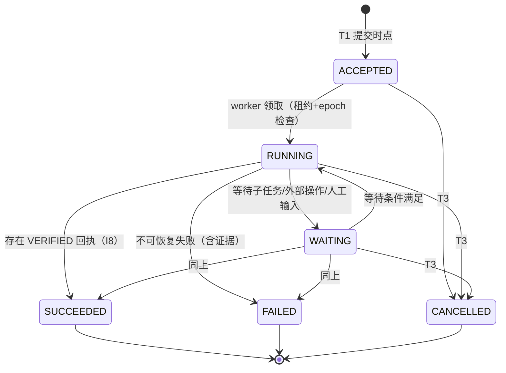

# 03 · 任务控制服务（TCS）设计

状态：v0.1 草案 ｜ 上游：总体方案 §5.3、§六、§8、§13.2 ｜ 前置：01、02

## 1. 职责与边界

TCS 是本域任务协作的**唯一权威控制面**：命令接纳（去重）、任务状态机、版本/epoch 分配、预算账本、业务操作接纳、回执签发、outbox 投递。

**不属于 TCS**：模型推理与计划生成（RUN）、权限策略判定（ICS 是 PDP，TCS 是执行点之一）、协议编解码（GW/ADP）、产物内容管理（ART）。TCS 只保存引用与摘要。

部署形态：MVP 为单主 + 热备（被动）；按任务分片扩容属 M4 议题（12 §3）。

## 2. 任务契约（Contract）

`contracts.body` 的规范结构（JSON Schema 2020-12 摘要）。自然语言 `goal` 便于理解；**其余字段是执行约束，程序检查，摘要/压缩不得改写**（09 §2）。

```json
{
  "contract_id": "con_0192...",
  "version": 7,
  "goal": "分析私有实验数据集 D，产出周报级统计表与可追溯报告",
  "input_refs": [
    {"artifact_id": "art_0190...", "digest": "sha256:…", "version": 3, "data_class": "confidential"}
  ],
  "output_schema": {"$ref": "https://schemas.<domain>/stat-report-2026-07.json"},
  "acceptance_policy": {
    "verifier": "stat-report-v2",
    "checks": ["sample_range", "units", "code_reproducible", "stat_consistency"],
    "on_fail": "report"                       // report | retry_once | human
  },
  "constraints": {
    "time_range": {"from": "2026-09-01", "to": "2026-09-30"},
    "units": "SI",
    "language": "zh-CN",
    "data_boundary": {"row_level_egress": false, "allowed_domains": ["dom_lab_b"]}
  },
  "authority_ref": "grt_0191...",
  "budget_ref": "acc_0191...",
  "deadline": "2026-11-01T09:00:00Z",
  "delegation_policy": {"allow": true, "max_depth": 3, "scope": ["search", "compute", "review"]},
  "evidence_policy": {
    "required": ["input_versions", "method", "artifacts", "provenance"],
    "retention_days": 365
  },
  "recovery_policy": {
    "on_disconnect": "resume",
    "on_unknown_effect": "reconcile_then_escalate",
    "on_validation_fail": "report",
    "offline_allowlist": []                   // 失联期间仍可接纳的操作类（06 §5.4）
  }
}
```

规则：

- R2.1 契约一经接纳即不可变；修改 = 新版本号 + 新 digest，存量任务继续引用旧版本。
- R2.2 `goal` 允许自然语言；`constraints/acceptance_policy` 必须机器可判定（MVP 限定为上表枚举的检查项，验证器接口见 09 §7）。
- R2.3 "分析这份数据"级别的模糊契约在接纳时被拒（`ANET-CMD-CONTRACT-INVALID`）：缺 `input_refs` 版本、`output_schema`、`budget_ref`、`deadline` 任一项不得接纳。

## 3. 命令封装（Command Envelope）

内部结构（跨域时由 GW/ADP 映射到标准协议 + 协商扩展，08 §4）。字段规范：

| 字段 | 类型 | 填写方（01 §5） | TCS 校验 |
|---|---|---|---|
| `profile` | `"agent-network/0.1"` | 调用方 | 必须匹配 |
| `command_id` | `cmd_` | 调用方（幂等键） | 去重（04 §3） |
| `task_id` | `task_` | 调用方 | 存在且未终态（新任务接纳时为空） |
| `parent_task_id` | `task_` | 调用方 | 委托深度与契约 `delegation_policy` |
| `caller_ref` | 主体引用 | GW 覆盖写入 | 等于已验证令牌身份 |
| `audience` | `dom_` | 调用方 | 在授权 `anet.aud_domain` 内 |
| `contract_ref` | `con_`+version | 调用方 | digest 一致 |
| `authority_ref` | `grt_` | TCS 签发回填 | 存在、active、作用域匹配 |
| `reservation_ref` | `res_` | TCS | HELD 且金额足够（05 §4） |
| `expected_task_version` | int | 调用方 | 不匹配 ⇒ `ANET-TSK-VERSION-CONFLICT`（防陈旧提议） |
| `evidence_manifest_ref` | `evm_` | 调用方 | 摘要校验（09） |
| `payload_digest` | `sha256:` | GW 计算 | 与去重记录一致（I3） |

## 4. TCS API（gRPC `anet.tcs.v1`）

MVP 服务方法（SDK 边缘由 GW 暴露 HTTPS/JSON 等价物）：

| 方法 | 用途 | 关键语义 |
|---|---|---|
| `SubmitCommand(env) → AdmissionResult` | 任务接纳（T1） | 幂等：重复 `command_id` 返回既有结果；参数不一致返回冲突 |
| `GetTask(task_id) → TaskSnapshot` | 查询 | 快照含状态/版本/epoch/效果/回执/预算摘要/子任务 |
| `UpdateTaskStatus(task_id, from→to, expected_version, evidence) → TaskSnapshot` | 状态迁移 | 状态机守卫（§5）；SUCCEEDED 需 VERIFIED 回执（I8） |
| `CreateSubtask(parent, contract, shrunk_rights) → AdmissionResult` | 子任务委托 | §7，一次事务完成收缩授权 + 子账户 + 事件 |
| `AdmitEffect(effect 提议) → EffectAdmission` | 业务操作接纳（T2） | 04 §4 |
| `ReportEffectResult(effect_id, attempt_id, outcome, usage) → EffectState` | 结果上报 | COMMITTED/REJECTED/UNKNOWN；结算联动（05 §5） |
| `CancelTask(task_id, cause) → CancelResult` | 取消（T3） | §6.3 |
| `ReserveBudget / SettleReservation / ReleaseReservation` | 预算（05 §3–§5） | — |
| `AcquireLease / RenewLease(task_id, worker, epoch)` | 租约（04 §5） | 续期失败 ⇒ 接管流程 |
| `ListUnknownEffects(filter) → [...]` | 对账工作队列 | 04 §6 |

所有写方法的响应都包含"提交后"的权威状态，调用方不得自行推断。

## 5. 任务状态机



迁移守卫（`UpdateTaskStatus` 逐条检查）：

| 迁移 | 守卫 |
|---|---|
| `→ RUNNING` | 存在有效租约且 `lease.epoch = current_epoch` |
| `→ SUCCEEDED` | 契约 `acceptance_policy` 对应 `VERIFIED` 回执已存在；或策略声明 `auto_accept` 且输出通过 schema 校验 |
| `→ FAILED` | 附失败原因与至少一项证据引用；存在 UNKNOWN 业务操作时**不得**报 FAILED（先对账，04 §6.4） |
| `→ CANCELLED` | 仅经 T3 路径；任何组件不得绕过取消记录直接改状态 |
| 终态 → 任何 | 拒绝（触发器 `trg_task_guard` 兜底，I4） |

任务状态与业务操作状态**分线维护**：任务 CANCELLED 后，已接纳 effects 继续对账直至终态（04 §7），二者互不掩盖。

## 6. 三个提交时点（T1 / T2 / T3）

### 6.1 T1 任务接纳

```text
SubmitCommand(env):
BEGIN;                                        -- 锁序：command_inbox → tasks → grants → accounts
  row := SELECT * FROM command_inbox
         WHERE command_id=env.command_id AND audience_domain_id=env.audience;
  IF row EXISTS:
      IF row.payload_digest ≠ env.payload_digest:
          ABORT ANET-CMD-PARAMS-CONFLICT;     -- I3
      COMMIT;  RETURN {EXISTING, row.task_id, 原 ACCEPTED 回执};   -- 幂等重放
  IF now() > env.deadline OR 契约不完整: ABORT ANET-CMD-CONTRACT-INVALID;

  INSERT command_inbox(expires_at = now()+tcs.dedup_retention);
  INSERT contracts(若新);                       -- 校验 digest
  task := INSERT tasks(status=ACCEPTED, version=1, epoch=1,
                       limits=根任务限额快照, delegation_depth=parent.depth+1);
  INSERT grants(初始授权 = 调用方已验证授权 ∩ 本域策略);      -- 06 §4
  IF 根任务: INSERT budget_accounts(每维度, budget_limit=limits.budget);
  INSERT task_events(TASK_ACCEPTED);
  rct := INSERT receipts(ACCEPTED, issuer=本域);             -- I1：提交后才能返回
  INSERT outbox(TASK_ACCEPTED);
COMMIT;
RETURN {rct, task.task_id};
```

要点：**回执在 COMMIT 之后才序列化返回**（I1）；`command_id → task_id` 映射与任务同事务落库（远端句柄丢失窗口的恢复依据，04 §3.3）。

### 6.2 T2 业务操作接纳

```text
AdmitEffect(prop):                            -- prop 含 effect_id, target, capability,
BEGIN;                                        --        params_digest, reservation_ref, 敏感级
  t := SELECT * FROM tasks WHERE task_id=prop.task FOR UPDATE;
  IF t.status IN 终态:            ABORT ANET-EFF-TASK-TERMINAL;
  IF t.cancel_version IS NOT NULL: ABORT ANET-EFF-TASK-CANCELLED;   -- I9
  IF prop.epoch ≠ t.current_epoch: ABORT ANET-EFF-FENCED;           -- I2
  IF env.expected_task_version ≠ t.task_version: ABORT ANET-TSK-VERSION-CONFLICT;

  e := SELECT * FROM effects WHERE effect_id=prop.effect_id;
  IF e EXISTS:
      IF e.params_digest ≠ prop.params_digest
         OR e.authority_digest ≠ prop.authority_digest:
          UPDATE effects SET state='CONFLICT';  ABORT ANET-EFF-PARAMS-CONFLICT;  -- I3
      COMMIT;  RETURN {EXISTING, e};           -- 重试幂等

  -- 授权检查（敏感级要求新鲜度，06 §4）：ICS 判定在事务前完成并携带时间戳，
  -- TCS 校验 now()-decision.at ≤ authz.sensitive_max_age 且 grant 状态未变
  -- 预算检查（05 §4）：reservation 必须为 HELD、归属本任务、金额 ≥ 上界
  res := SELECT * FROM budget_reservations WHERE reservation_id=prop.reservation FOR UPDATE;
  IF res.state ≠ 'HELD' OR res.amount < prop.cost_upper_bound: ABORT ANET-BUD-RESERVATION-INVALID;

  INSERT effects(state=ADMITTED, epoch=t.current_epoch, authority_digest=hash(grant+约束));
  UPDATE budget_reservations SET effect_id=prop.effect_id;
  INSERT task_events(EFFECT_ADMITTED);
COMMIT;                                        -- 外部调用在提交后由 ADP 执行（04 §4.3）
```

### 6.3 T3 取消

```text
CancelTask(task_id, cause):
BEGIN;
  t := SELECT * FROM tasks WHERE task_id FOR UPDATE;
  IF t.status IN (SUCCEEDED, FAILED):
      ABORT ANET-TSK-TERMINAL;                -- 已完成/已失败的任务不"取消"
  IF t.status = CANCELLED:
      COMMIT; RETURN {EXISTING, t.cancel_version};             -- 取消幂等
  UPDATE tasks SET status='CANCELLED', cancelled_at=now(),
         cancel_version=COALESCE(cancel_version,0)+1,
         task_version=task_version+1;
  INSERT task_events(CANCELLED, cause);
  INSERT outbox(CANCELLED);                    -- 投递器：本域子任务逐个 T3；跨域发取消命令
COMMIT;
RETURN {t.cancel_version};
```

取消语义（总体方案 §8.6 的落地）：T3 提交后，本域**不再接纳**该任务任何新操作（T2 守卫）；**已接纳**操作继续执行/对账直至终态，其结果照常写入 `effects/receipts`。跨域取消是"请求 + 对端确认"：本地取消不表述为对端已停止（08 §4.4）。

## 7. 子任务创建（委托）

`CreateSubtask` 单事务完成四件事（缺一即整体失败）：

1. 契约校验：子契约满足 R2.3；`delegation_policy.allow`；`parent.depth + 1 ≤ max_depth`；
2. 权限收缩：`Rights_child ⊆ Rights_parent ∩ Policy_recipient`（判定算法 06 §3），生成子 `grants` 记录；
3. 预算分配：父账户下建子账户（从父账户 `delegated` 或预留转移额度，05 §6.2）；
4. `task_events(SUBTASK_CREATED)` + outbox（如跨域，由 ADP 发起对端接纳）。

跨域子任务的权威在对端域；本域保存 `peer_task_ref` 与 ACCEPTED 回执，**不**镜像对端内部状态。

## 8. Outbox 与投递器

- 事务内只写 `outbox` 行；投递器进程轮询 `status='PENDING' AND next_attempt_at<=now()`，按 `dedup_key`（`peer+message_id`）幂等投递，指数退避（`tcs.outbox_max_attempts=16`，超限转 `DEAD` 并告警）。
- MVP 投递器为进程内后台协程；M2 起可替换为 NATS JetStream 唤醒（权威事实仍在库，02 §1）。

## 9. 配置参数（初始值）

| 参数 | 默认 | 说明 |
|---|---|---|
| `tcs.dedup_retention` | 168h | command_inbox 保留期，必须 ≥ 重试窗口（04 §3.2） |
| `tcs.command_retry_window_max` | 24h | 调用方重试窗口上限 |
| `tcs.lease_ttl` | 30s | worker 租约 |
| `tcs.lease_grace` | 15s | 接管判定 = 过期 + grace |
| `tcs.outbox_max_attempts` | 16 | DEAD 前投递次数 |
| `db.lock_timeout` | 2s | 行锁等待上限 |
| `limits.max_delegation_depth` | 3 | 根任务默认 |
| `limits.max_concurrent_subtasks` | 16 | — |
| `limits.max_model_calls` | 200 | 根任务默认（05 §6） |
| `limits.max_messages` | 2000 | 根任务默认 |
| `authz.sensitive_max_age` | 60s | 敏感写操作授权判定新鲜度 |

## 10. TCS 错误码

`ANET-CMD-*`：`PARAMS-CONFLICT / EXPIRED / CONTRACT-INVALID / AUDIENCE-DENIED`
`ANET-TSK-*`：`TERMINAL / VERSION-CONFLICT / STATE-GUARD-FAILED / NOT-FOUND`
`ANET-EFF-*`：`TASK-TERMINAL / TASK-CANCELLED / FENCED / PARAMS-CONFLICT / RESERVATION-INVALID`（04 §9 续）
