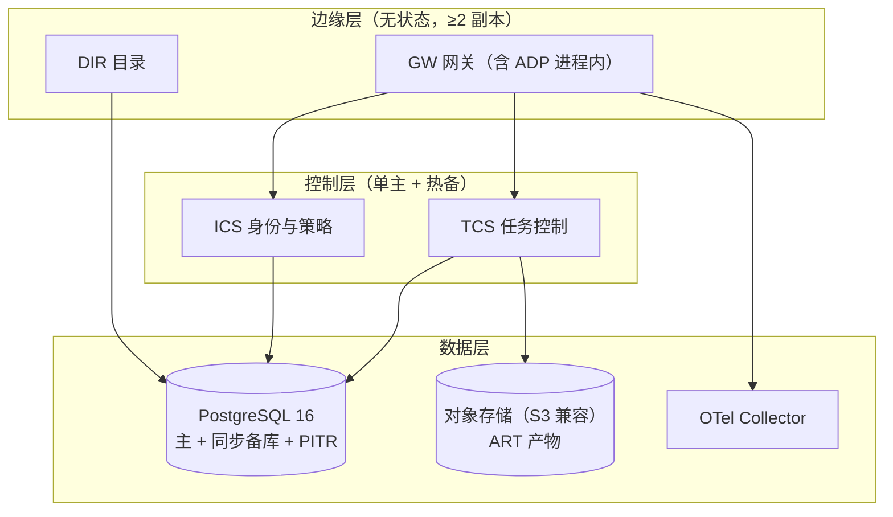

# 12 · 部署拓扑与容量设计

状态：v0.1 草案 ｜ 上游：总体方案 §13 ｜ 前置：02、10

## 1. 域内拓扑（逻辑组件 → 部署单元）

- MVP 合并部署：GW+DIR 同 Pod；TCS+ICS 同进程不同模块——逻辑接口（00 §2）不变，拆分是运维动作不是代码重构。
- 三个信任域 = 三套独立部署 + 各自 PG/对象存储；互为对端。
- worker（RUN）按需水平扩，凭证经 ICS 注册，受 04 §5 租约机制管理。

## 2. 环境

| 环境 | 用途 | 形态 |
|---|---|---|
| devnet | 三域联调、故障注入（13 §3） | docker compose 单机起三域 + 模拟业务系统 + 恶意对端 |
| staging | 基准实验（13 §4） | 同拓扑、冻结模型/工具版本 |
| prod | 试点 | 每域独立集群 |

## 3. 高可用与故障切换

| 组件 | 方案 | RPO/RTO 目标（M4 验证） |
|---|---|---|
| PostgreSQL | 流复制同步备库 + 每日基线 + WAL 归档（PITR） | RPO=0 / RTO ≤ 5min |
| TCS/ICS | 单主 + 热备（心跳+租约选出）；无内存权威，重启即恢复（04 §8.1） | RTO ≤ 2min |
| GW/DIR | 无状态多副本 + LB | 秒级 |
| 对象存储 | 纠删码多副本；摘要可校验 | — |

## 4. 备份与恢复

- 每日全量 + WAL 归档保留 35d；恢复演练进 M4 演练清单；
- 迁移前必须打快照点（02 §7 回滚依据）；
- 密钥/信任锚异地备份，泄露轮换流程 = 01 §7 撤销 + 重新签发域证书。

## 5. 保留与归档（与 02 §5 联动）

| 数据 | 热存 | 归档 | 删除 |
|---|---|---|---|
| task_events | 180d（分区） | 对象存储 parquet + 索引 | 按域合规策略（默认 3y） |
| audit_log | 365d | 同上 | 合规决定 |
| outbox DONE | 7d | 不归档 | 清理任务 |
| command_inbox | 至少 168h，且不早于 not_after | 不归档 | 过期清理 |
| artifacts | 契约 `evidence_policy.retention_days` | 冷存储 | 到期经所有者确认 |

归档作业（分区 detach → 导出 → 校验 digest → 删除）每日运行，属于 M1 交付而非后续优化。

## 6. 容量规划（v0.2：自洽重算；评审 §十二指出 v0.1 数字自相矛盾）

目标负载（承接总体方案 §13.4 假设）：200 msg/s、0.78 MiB/s、66 GiB/日原始消息、三副本 ~198 GiB/日。

**热存自洽计算**（按 02 §5 速率）：

| 数据 | 热存速率 | 保留 | 热存体量 |
|---|---|---|---|
| task_events（含索引系数 1.5×） | 13 GiB/日 | 180d | **3.5 TiB** |
| audit_log（含索引 1.5×） | 12 GiB/日 | 365d | **4.4 TiB** |
| outbox 终态行 / command_inbox / receipts / effects | ~1 GiB/日 | ≤7d / 滚动 | ~0.1 TiB |
| **合计** | | | **≈ 8.0 TiB** |

| 项 | 首版配置 | 依据 |
|---|---|---|
| PG 主库 | 16 vCPU / 64 GiB / **NVMe 16 TiB**（8 TiB 数据 + WAL 归档 + 索引重建/维护余量 2×安全系数） | 上表 + 复制槽滞留余量 |
| 对象存储 | 起步 20 TiB | 产物与归档分离 |
| GW | 4 vCPU/8 GiB ×2 | 200 msg/s + TLS |
| TCS | 8 vCPU/16 GiB ×2（主备） | 事务主导 |

（v0.1 的"4 TiB 主库"与自身增长模型矛盾，已修正；若需压缩热存，先下调 audit_log 保留或启用分区级压缩，须同步改 02 §5 与合规审批。）需要压测确认（13 §4 规模档）：目录记录数（≤10⁴）、活跃任务数（≤10³）、真实模型并发（≤10²）。**大量逻辑 Agent 的模拟结果不得外推为同等数量复杂 Agent 的协作能力**（总体方案 §14.5 提醒）。

## 7. 配置与变更管理

- 全部参数集中在域级配置清单（03 §9、05 §9、07 §7 汇总为唯一 inventory，版本化发布）；
- 策略/映射表/路由档位变更走策略版本发布（06 §7），旧任务沿用接纳时版本；
- 升级顺序：DB 迁移 → ICS/TCS → GW/DIR → worker SDK；滚动且每个对端协议版本兼容窗口内完成（08 §6）。

## 归档实现进展（2026-10-27）

25 已实现 `archived` 的每日周期、月分区冻结/摘除、Parquet/S3 分片、远端校验、事务删除与持久恢复。CLI 可查询热表/摘除源表/已归档对象；失败不会静默截断记录。过期清理保留所有未完成投递、投递去重和业务事实。当前不执行冷对象到期删除或 artifacts 删除；部署时必须配置域保留策略及私有桶访问权限。容量/恢复目标仍须按 M4 验证。
